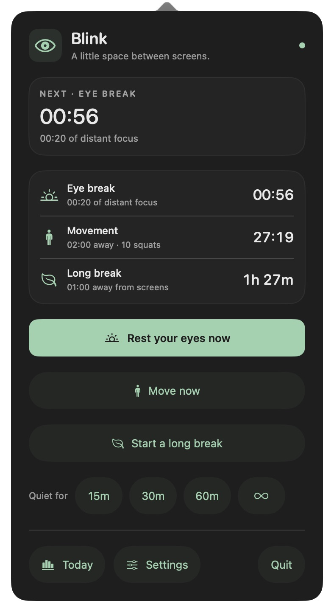

# Blink

A native macOS menu bar app for small eye breaks, optional movement breaks, complete-blink reminders, and longer pauses away from screens. For Apple silicon (M1 or later), macOS 26 or later.

**Status:** preview. This guide describes the current source; packaged builds can differ. See [verification](docs/verification.md) for how changes are verified and which acceptance checks remain open.

[Download the Development preview](https://github.com/larinam/blink/releases/tag/development) · [Build from source](#build-and-run-from-source)

<p></p>

*The menu with customized timings and movement reminders enabled.*

## Download and install

Preview app downloads are distributed through [GitHub Releases](https://github.com/larinam/blink/releases). Numbered releases are fixed versions; the rolling **Development** pre-release follows `main` and is replaced by each new build. Download the ZIP and the checksum file from the same release. The ZIP contains `Blink.app`, installation instructions, and the MIT license. Xcode is only needed to build from source.

Unzip the download, quit any existing Blink instance, move `Blink.app` into Applications, then open it. These previews are **ad-hoc signed and not notarized by Apple**. If macOS cannot verify the developer and you trust the download, follow **System Settings → Privacy & Security → Open Anyway** after attempting to launch it. See [Apple's instructions](https://support.apple.com/en-us/102445); managed Macs may restrict this option. Follow the included `INSTALL.md` for checksum verification and updates. A damaged-app or malware warning needs investigation instead of this exception.

Find the eye icon in the menu bar after setup. Enable launch at login only after moving the app to its permanent location. The [release guide](docs/releases.md) covers both channels, packaging, and download verification.

## Build and run from source

Requires Xcode 27 selected as the active developer directory (`sudo xcode-select -s /Applications/Xcode.app`). The standalone Command Line Tools lack the required SwiftUI macro plugins; build scripts fall back to `/Applications/Xcode.app`. No third-party dependencies or account are needed.

```sh
scripts/build.sh
open build/Blink.app
```

The build script creates an ad-hoc signed `build/Blink.app`, including its app icon and menu-bar-only configuration. Use the app bundle, rather than the raw Swift executable, for normal use and launch at login. For a permanent installation, copy the bundle to a stable location such as `~/Applications` before enabling launch at login in Settings.

```sh
swift test
```

Native UI tests are opt-in and briefly show test windows. See [development and verification commands](docs/development.md) for pointer targets, rendering, blink animation, and overlay checks; ordinary `swift test` skips those checks.

Open `Package.swift` in Xcode to work on the source. `scripts/build.sh debug` creates a debug app bundle.

## Daily use

- Complete the screen-setup guide, then find the eye icon in the menu bar.
- By default, an eye break is due after 20 counted minutes, a 15-minute long break after 120 counted minutes, and a silent blink cue every minute.
- Optional movement breaks suggest 10 squats after 60 counted minutes, with two minutes away from the screen. Enable them in Settings and choose squats, sit-ups, walking, stretching, or simply stepping away. Repetitions are not tracked; movement reminders stay off until enabled.
- Coincident reminders become one invitation: long break, then movement, then eye break. Completing movement resets the eye and movement schedules while preserving long-break progress; completing a long break resets all three.
- Prompts wait for you to choose Start, Snooze 5 minutes, or Skip. Started breaks dim every display and always have an End break control. The dimming layer leaves the rest of your workspace clickable.
- Quiet mode silences reminders for 15, 30, or 60 minutes, or until resumed. Eligible screen time still counts. A manually started break remains visible, and your quiet period continues afterward.
- Five minutes without keyboard or pointer activity is treated as absence. Turn this off for quiet reading if needed. Lock and sleep still pause screen-time counting.
- Settings includes independent switches, timing controls, previews, completion sound, and optional launch at login. Save applies reminder edits; changing a timer restarts that schedule. Unsaved edits survive page changes and closing/reopening Settings until Blink quits. Launch at login applies immediately.
- Restoring recommended defaults turns optional movement reminders off; enable them again to resume the hourly schedule.
- Today contains timed eye, movement, and long-break completions, skipped/ended-early breaks, and snooze actions. It resets at local midnight. Natural absences adjust the schedule without adding guided completions.

On a U.S. keyboard, press **⌃⌥⌘B** (Control–Option–Command–B) from any app to open Blink. Settings shows the corresponding key for your current keyboard layout and updates when it changes. It registers only that shortcut with macOS and does not monitor ordinary keystrokes. Settings reports if another registration prevents the shortcut from being available.

With VoiceOver, a newly visible break prompt is announced once with instructions for opening Blink. Break completion is also announced, independently of the optional chime. Quiet mode silences automatic prompts; a break you start manually still announces completion. Silent blink cues remain unannounced. Scheduled prompts leave focus in your current app.

While Blink is active, **⌘,** opens Settings, **⇧⌘R** opens the current reminder (or menu panel), **⇧⌘B** starts an eye break, **⇧⌘M** starts a movement break (or opens Settings if disabled), and **⇧⌘L** starts a long break. Escape ends a focused break or closes its preview.

## Privacy and storage

Blink works offline. It does not use the camera, microphone, screen recording, input event taps, accounts, or telemetry. The inactivity check reads elapsed time since input; it does not read what you type.

Settings, schedule progress, and today's counters are stored atomically in:

```text
~/Library/Application Support/Blink/state.json
```

No daily history is retained. Break completion means a timer finished, not that gaze, blinking, or rest was verified. Eye care guidance is a habit aid, not a promise to prevent or treat eye conditions.

Only one Blink process can use a saved-data folder at a time. Opening another copy with the same folder shows an explanation and exits before loading or saving state. Ownership ends automatically if Blink quits or crashes.

Older builds without this protection do not coordinate with it. Quit them before running a newer build against the same saved-data folder.

If saved state cannot be read, Blink runs with temporary defaults and leaves the file untouched until an explicit reset in Settings. For isolated development storage, set `BLINK_STATE_DIR` before launching the executable inside the bundle; see [development](docs/development.md#build-and-isolated-use).

## Documentation

See the [documentation index](docs/README.md) for product requirements, architecture and source map, design decisions, interface details, development commands, releases, and verification. Generated builds and local QA output are excluded from Git.

## Contributing and security

See [Contributing](CONTRIBUTING.md) for development setup, checks, and pull request guidance. Report vulnerabilities privately as described in the [security policy](SECURITY.md).

## License

Blink is available under the [MIT License](LICENSE).
